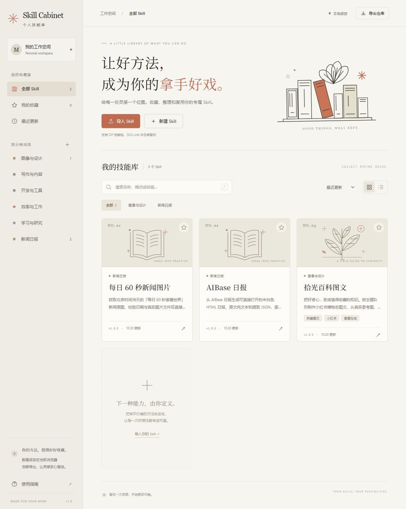
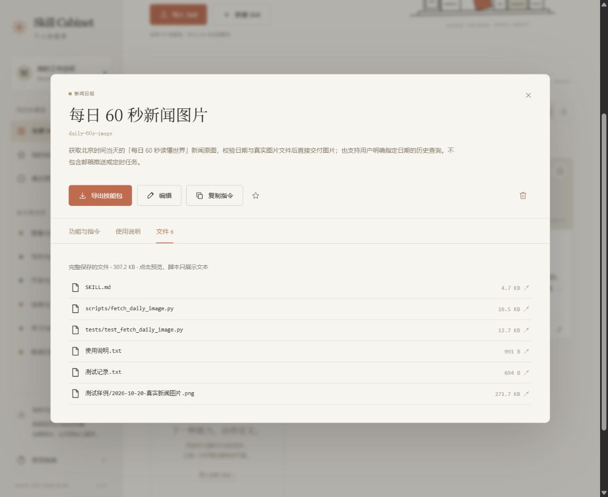
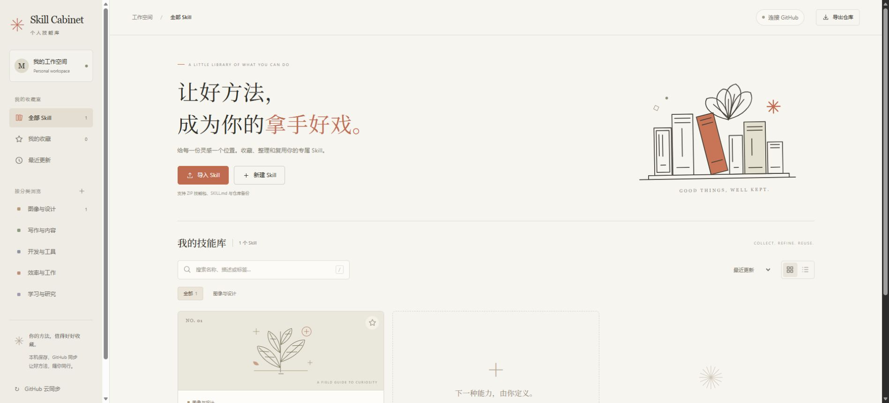

<div align="center">


### 让好方法，成为你的拿手好戏。

给每一份灵感一个位置。收藏、整理和复用你的专属 Skill。


[项目预览](#项目预览) · [快速开始](#快速开始) · [技能收藏](#技能收藏) · [GitHub 云同步](#github-云同步)

</div>

---

**Skill Cabinet 是一个轻量的个人 AI 技能管理页面。** 把散落在文件夹里的 SKILL.md、使用说明、脚本和参考图片收进同一个书架，按分类找到它们，继续打磨，再导出成完整技能包。

界面借鉴 Anthropic 的暖白纸面、陶土色强调和衬线排版，使用独立标识与自制 SVG 插图。纯 HTML、CSS 和 JavaScript，启动项目不需要安装 npm 依赖。

## 项目预览

下面是实际运行截图，展示当前收藏的三份 Skill。



<details>
<summary><strong>展开查看 · 技能详情与完整文件清单</strong></summary>

<br>


</details>

<details>
<summary><strong>展开查看 · GitHub 云同步连接设置</strong></summary>

<br>


</details>

## 能做什么

| 收藏 | 整理 | 使用与迁移 |
| :--- | :--- | :--- |
| 导入 ZIP 技能包、SKILL.md | 分类、标签、收藏 | 查看功能与 Markdown 指令 |
| 拖拽文件导入 | 名称、描述、标签搜索 | 复制最新指令 |
| 新建或编辑 Skill | 最近更新、名称排序 | 预览参考图片与文本文件 |
| 保留脚本、图片及参考资料 | 网格与列表视图 | 单个技能导出、全库备份恢复 |

导入的 Skill 作为文件内容保存。包内脚本仅用于阅读与导出，管理页面不会执行这些脚本。

## 三个收藏空间

侧栏可切换「我的 Skills 空间」「提示词收录」与「我的 GitHub 空间」。

- **Skills 空间**：保留完整技能包、分类、编辑、备份和 GitHub 云同步。
- **提示词收录**：收录标题、用途、完整正文、分类、标签和来源，支持收藏、正文搜索、排序、编辑、另存副本与一键复制。正文使用 `{{变量名}}` 时，可在详情中填写后复制。支持自定义分类、JSON 备份导出与增量恢复、移除后撤销。
- **GitHub 空间**：粘贴 GitHub 仓库地址，点击「识别并添加」，自动读取项目名称、简介、README、语言、技术标签和 Star 数，并按用途归类；支持搜索、收藏、编辑名称与用途、自定义分类，以及 JSON 备份导出和恢复。

项目用途来自仓库简介与 README；分类由名称、简介、topics 和 README 中的关键词匹配产生。无须配置模型 API，识别结果可手动调整。公开仓库可直接读取；若 Skills 空间已连接 GitHub，会使用现有凭据发起读取请求。读取私有仓库需要令牌已被授权访问该仓库。

提示词会先保存到浏览器，再自动写入 `skill-cabinet/prompts.json`。使用 `node server.mjs` 启动项目时，每 5 秒检查本机仓库；其他设备提交提示词后，在当前设备执行 `git pull` 即可自动显示。不同提示词的修改自动合并，同一条内容两边都有修改时需要选择版本。写入接口使用版本校验，避免覆盖并发修改。提示词文件可随代码提交到 GitHub；现有「GitHub 云同步」只同步 Skill 和 GitHub 项目收藏。使用纯静态托管时，提示词仍可在浏览器保存、导出和恢复，本机文件写入不可用。

GitHub 项目收藏先保存在当前浏览器，**现已与 Skills 共用 GitHub 云同步**。连接一次后，项目的添加、改名、用途、分类、标签、收藏和移除会一起同步；不会修改所收藏项目的原仓库。项目仍提供单独的 JSON 导出与恢复，不包含在 Skills 的 ZIP 备份里。凭据只用于固定的 GitHub API 请求，不进入项目资料或 JSON 备份。

已加入用户指定的 `mexicat/pdoom-video`、`Tunai-0511/meme67-art-history`、`Vincentwei1021/mg-styles-15`、`lemomo-ai/lemo-opuscar`、`heygen-com/hyperframes` 和 `remotion-dev/remotion`，均归于「设计与创作」。Lemo-Opuscar 提供影片风格提示词与演示短片；HyperFrames 面向 AI 编程助手制作视频；Remotion 以 React 和 TypeScript 编程制作视频，支持组件、播放器、批量渲染及视频应用开发。Remotion 的完整名称、用途、标签和指纹同时写入初始目录与同步清单。初始资料位于 `dist/assets/github-projects.json`；首次读取时加入浏览器，保留已有修改，主动移除后刷新不会重新补回。

已收录 [VoiceStudio](https://github.com/debpalash/VoiceStudio)，名称为「VoiceStudio · 本地 AI 语音工作站」，归于「AI 与智能体」。用途涵盖语音克隆、音色设计、视频配音、听写、转写和有声书制作，并提供本地模型管理、API 与 MCP 集成；同样保存在初始项目目录与云同步清单中。

## 快速开始

需要 **Node.js 20 或更新版本**。

```bash
git clone https://github.com/XiaoyeCodes/Skill-Cabinet.git
cd Skill-Cabinet
npm start
```

打开 [http://localhost:4173](http://localhost:4173)。本地服务会直接读取仓库的 `skill-cabinet/manifest.json` 和完整 ZIP，当前包含二十六份 Skill / 技能集，覆盖设计、视频、产品、写作、研究、新闻与投资金融。无需填写 GitHub Token，也无需手动导入备份；已经只保存了一份 Skill 的旧浏览器也会自动补齐。

「Huashu Design · 花叔设计」归于「图像与设计」，版本为 3.0.0，已同步至 [alchaincyf/huashu-design 的 4fc7bfd 提交](https://github.com/alchaincyf/huashu-design/tree/4fc7bfdbd5ec3fa2d43ce7a6433de60976a5e4b1)。本次更新 3.0 发布案例、双语 README 和作者资料。完整技能包保留上游 389 个文件及 MIT 许可证，另附使用说明、原始 `SKILL.md` 副本与逐文件来源校验记录，共 392 个文件；素材、参考文档、脚本与演示均包含在内。

「女娲 · Skill造人术」归于「学习与研究」，版本为 1.0.0，来自 [alchaincyf/nuwa-skill](https://github.com/alchaincyf/nuwa-skill/tree/7812110bf7e5a2b01b6aa5a738568044121bbfa2)。完整技能包保留上游 162 个文件、15 份人物示例及 MIT 许可证，另附使用说明和原始 `SKILL.md` 副本。

「Huashu Motion · 花叔动画」归于「图像与设计」，已从 0.1.1 升级到 0.3.1，来自 [alchaincyf/huashu-motion 的 52467f9 提交](https://github.com/alchaincyf/huashu-motion/tree/52467f99c602b76ba86d511d37acdfe93fa1e16e)。更新包含产品素材抓取、分享 GIF、配乐指南、Three.js 深度场景和新模板，以及运行时和检查工具修正。技能包保留 306 个上游文件，包含 CLI、运行时、编辑器、字体、模板、示例、测试及许可；另将参考文档和启动入口整理到包根目录，提供 Windows 入口、说明与来源校验记录，共 355 个文件。仅沿用旧包对官网宣传 GIF 的排除，当前 9 个文件的路径和理由记录在 `upstream/source.json`，可在上游仓库查看。实际执行需要 Node.js 22+、Chrome/Chromium/Edge 与 FFmpeg；第三方组件及演示角色的许可见包内 `THIRD_PARTY.md`、`fonts/LICENSES.md` 与 `runtime/three/LICENSE`。

「暖纸编辑设计」归于「图像与设计」，版本为 1.0.0，是个人的跨媒介设计 Skill，适用于网页、图片、Word 和 PDF。完整包包含配色与排版规范、CSS、原创 SVG 线稿与标记、用户参考图、图像提示词指南和对比度检查脚本；另附使用说明及原始指令副本，共 16 个文件。

「仓颉 · 知识蒸馏」归于「学习与研究」，版本为 2.5.0，来自 [kangarooking/cangjie-skill](https://github.com/kangarooking/cangjie-skill/tree/a28de55ba881b9928956a55048f743f7a9e3b23e)。完整保留 367 个上游文件，含方法论、提取器、模板、Python 工具链和示例；另附原始指令、使用说明和来源记录，共 370 个文件。

「穷查理宝典 · 思维与决策」归于「学习与研究」，来自 [kangarooking/poor-charlies-almanack-skill](https://github.com/kangarooking/poor-charlies-almanack-skill/tree/d477e516920995b6e54d66c7441f17048188303a)，含 12 个子技能，完整保留 74 个上游文件，打包后共 77 个文件。「巴菲特股东信 · 投资方法」归于新建的「投资与金融」，来自 [kangarooking/buffett-letters-skill](https://github.com/kangarooking/buffett-letters-skill/tree/5b1fbe1d93f155fcf4acf236841bf8e1b5951c91)，含 20 个子技能，完整保留 54 个上游文件，打包后共 57 个文件。两套均按完整技能集展示，增加根目录导航入口；原始模块、索引、候选与淘汰记录、测试用例和 MIT 许可证保持原样。收藏入口版本为 1.0.0，上游未声明发布版本。

[xie-bros/doubao-skills](https://github.com/xie-bros/doubao-skills/tree/f43f4118c5abb8403e6bb66efd3c4163a8f50f80) 的 master 分支导入为 5 个独立条目。「付鹏 · 宏观与大类资产」「索罗斯 · 反身性与宏观对冲」「达里奥 · 经济周期与债务危机」「秦小明 · 金融思维」归于「投资与金融」，「黄执中 · 沟通与表达」归于「写作与内容」。分别保留 66、62、11、1、6 个原始文件，各加原始指令副本、仓库说明、来源记录与使用说明，打包后为 70、66、15、5、10 个文件。付鹏与索罗斯指令的非标准元数据分隔符已在导入版规范化，原件保持原样。条目版本为 1.0.0，上游未标注版本；仓库没有许可证文件，不额外声明许可。历史告警和带日期的表格作为资料保留，导入不会启动监控或脚本。

2026-10-22 同步了浏览器中更新的三份新闻 Skill：「AIBase 日报 · V7」（`aibase-daily`，18 个文件）、「每日60秒文字日报」（`generate-daily60-digest`，36 个文件）和「金十财经早餐」（`build-jin10-breakfast`，53 个文件）。正文、使用说明、完整附件与收藏状态随仓库保存。每日60秒和金十早餐使用新的技能标识，旧标识保留删除记录，避免换设备后重新出现旧条目；仓库仍为 17 个有效条目。下方「技能收藏」中的三份 ZIP 是原始初始包，当前内容以同步清单为准。

2026-10-23 新增「资深产品经理」（`senior-product-manager`），沿用上传时的「开发与工具」分类。完整包保留指令、Agent 配置、澄清与决策参考、产品设计书结构与质量标准，以及导出的使用说明，共 5 个文件；用于需求梳理、方案取舍和 PRD 交付。

2026-10-26 收录本机上传的「趣味科普动画视频」（`animated-explainer-video`），归于「图像与设计」。原始 `animated-explainer-video-skill.zip` 完整保存在同步归档中，SHA-256 为 `babafbe671d301b39ed0aa68ae7157161783664e626b6a8143b6794d0557a335`。包内共 41 个文件，保留土豆历史横屏案例、通用横竖屏模板、MoviePy/Pillow/NumPy 与 FFmpeg 制作脚本、Noto Sans SC 中文字体及 OFL 许可、19 段配音缓存和完整参考文档。用于制作带中文配音、字幕、配乐和原创动画的科普 MP4，并交付封面、分镜、SRT 与可编辑源码；实际制作需 Python、FFmpeg，生成新配音还需联网使用 edge-tts。

2026-10-26 收录「Vibe 知识短片 · 无旁白科普」（`vibe-knowledge-film`），归于「图像与设计」，来源为 [HeyChengC/vibe-knowledge-film](https://github.com/HeyChengC/vibe-knowledge-film/tree/62d51508aad00003dc6209afa80c4b5dc540de59)。它用 Canvas、JavaScript、Playwright 和 FFmpeg 制作无旁白的 16:9 横屏字幕知识短片，提供夜曲与寓言两套外观、讲解设计、分镜、逐帧渲染和音效流程。收藏包共 43 个文件，保留引擎、方法章节、作者自有题目示例与完整许可证；34 个未改动文件逐项核对了上游 Git blob 摘要。上游许可证排除的第三方字幕、画面记录、`stim_B` / `info_C` 复刻工程及截图改用原始链接；两张大型演示 GIF 也保留源链接。改动范围与来源记录见包内 `CABINET_SOURCE.json`，原始 `SKILL.md` 单独保留；首次制作仍需按上游流程准备 Python、Chrome、FFmpeg 并下载字体。

后续在项目目录执行 `git pull`，打开的页面会在约 **5 秒内**自动检查并显示新的技能数据；切回页面或点击「刷新本机仓库」也会立即检查并显示检查结果。这个按钮只读取本机已经拉取的技能内容，不会执行 `git pull` 或上传浏览器里的修改。**与 GitHub 云端交换数据请点击「同步到 GitHub」**，未连接时会打开设置。服务按请求读取磁盘文件，技能数据更新无需重启；修改前端代码后刷新页面，更新 `server.mjs` 等服务端代码后需重新运行 `npm start`。

未修改的仓库技能会随拉取结果更新或移除；浏览器中自行编辑、收藏或删除过的技能会保留，并显示「已保留本地差异」，悬停可查看名称。个人新建、导入的技能也保留。加载时会校验 ZIP 与清单，完整读取成功后才一次性保存；缺包、校验失败或同时发生本地修改时，保留现有数据并自动重试。

**新建分类也随仓库保存，包括没有 Skill 的空分类。** 本地运行时，添加分类会自动合并到 `skill-cabinet/manifest.json` 的 `categories` 列表。将该文件一并提交、推送到 GitHub 后，其他设备 `git pull` 即可自动显示。原先仅保存在浏览器中的分类会在打开新版页面时迁移。若启用了「GitHub 云同步」，分类也会随现有同步流程上传和恢复；多台设备新增的分类按名称合并、去重，不会相互覆盖。本地写入失败时保留浏览器副本并重试。页面不会自动执行 Git 提交或推送。

```bash
# 运行核心行为测试
npm test
```

无需执行 `npm install`。ZIP 引擎 JSZip 已随项目附带；字体无法在线加载时会使用系统字体。请通过 HTTP 服务打开页面，避免直接双击 HTML 带来的模块与资源访问限制。

## 技能收藏

三份完整技能包已随仓库提交，保留 **37 个原始文件**。下面的链接分别提供可阅读的源码和可直接导入的原始 ZIP。

| Skill | 能力 | 原始文件 | 文件与下载 |
| :--- | :--- | :---: | :--- |
| **拾光百科图文** | 按主题队列制作博物志科普图文，包含参考图、文案与质量核验流程 | 21 | [查看 Skill](skills/shiguang-atlas/SKILL.md) · [完整 ZIP](dist/assets/shiguang-atlas.zip) |
| **AIBase 日报** | 把 AIBase 日报整理为米白色 HTML、纯文本和提取 JSON | 10 | [查看 Skill](skills/aibase-daily/SKILL.md) · [完整 ZIP](dist/assets/aibase-daily.zip) |
| **每日 60 秒新闻图片** | 获取指定日期的新闻原图，校验日期与文件，并保留下载记录 | 6 | [查看 Skill](skills/daily-60s-image/SKILL.md) · [完整 ZIP](dist/assets/daily-60s-image.zip) |

**一次收好全部三份：** [下载初始技能库备份](backups/skill-cabinet-starter.zip)，在页面中点击「导入 Skill」选择该 ZIP，即可加入三份技能。已存在的标识会跳过，并提示保留已有内容。

原始 ZIP 保持原样；`skills/` 中的可读版本同步了展示名称和分类。压缩包外层的使用说明、测试记录和样例也保留在对应目录中。原始文件校验值见 [技能目录清单](docs/skill-catalog.json)。

**[UI/UX Pro Max -网页设计](https://github.com/nextlevelbuilder/ui-ux-pro-max-skill)**（v2.15.0，图像与设计）。用于网站、落地页、后台与组件的 UI/UX 设计，覆盖设计系统、风格、配色、字体、响应式布局、交互及无障碍检查。[下载完整技能包](skill-cabinet/archives/ui-ux-pro-max-598f80e5c909ae0dc82200c601601f695660a28555df022b8fbd2ce83326af1e.zip)，共 80 个文件，含上游核心技能的全部 73 个文件，以及许可证、说明和来源记录。来源提交为 `28b3b8dee8c976df4fa3e94aed4e092ad43fcb03`，已同步技术栈检索中数字被误识别为版本号的修复；包内保留原始指令，浏览器仅作保存、预览与导出。

新增三个独立条目，名称后缀直接说明用途：

| Skill | 分类 | 内容与使用 |
| :--- | :--- | :--- |
| **[Impeccable -网页设计优化](skills/impeccable/SKILL.md)** | 图像与设计 | [上游项目](https://github.com/pbakaus/impeccable) v4.8.0 的设计指导与 24 个命令，用于检查、优化和完善网页；保留完整技能资源与运行器。[下载技能包](skill-cabinet/archives/impeccable-965a3a6d7a936d38baf4d6fb34919d06581c4e0acf1b26dcded360f72ddc703d.zip)。首次实际运行命令可能需要联网获取引擎。 |
| **[Anthropic Skills -办公与开发技能合集](skills/anthropic-skills/SKILL.md)** | 开发与工具 | [官方仓库](https://github.com/anthropics/skills)以一个合集条目收录，通过目录按任务选择内部技能；共 19 项目录，14 项 Apache-2.0 技能保留本地文件，5 项提供官方链接。[下载合集](skill-cabinet/archives/anthropic-skills-610a32d6107201afcacb00d6f4d2bfee578f27adafb093247da994c49c1203c6.zip)。 |
| **[Anthropic Frontend Design -网页设计](skills/frontend-design/SKILL.md)** | 图像与设计 | 单独收录官方 frontend-design，方便直接调用，也保留在官方合集内。[下载技能包](skill-cabinet/archives/frontend-design-1ad473ec9230e80c479b54bd86e918b1c6d55bdc031cf45ebe7e1d1116944ccb.zip)。 |

官方合集中的 docx、pdf、pptx、xlsx 不允许再分发，doc-coauthoring 未声明单独许可，因此这五项只保留用途说明与官方来源入口，不附源文件。具体许可与调用方式见合集内的 [RIGHTS.md](skills/anthropic-skills/RIGHTS.md)。

以下两个设计 Skill 均归入「图像与设计」，各自是一个独立条目：

- **[Awesome DESIGN.md -网页设计风格库](skills/awesome-design-md/SKILL.md)**：把 [VoltAgent/awesome-design-md](https://github.com/VoltAgent/awesome-design-md) 包装为一个 Skill，84 份完整设计规范收在包内参考目录。用户可指定风格；未指定时，由 AI 询问用户或推荐 2–3 个候选后选择。附离线检索及不覆盖已有文件的导出工具。[下载完整包](skill-cabinet/archives/awesome-design-md-9a8a373eb8fcdc4d4a298907e2428d57c9cd8c26d3aa3c1cef2576159bece20a.zip)。
- **[克劳德设计](skills/claude-design/SKILL.md)**：基于 [getdesign.md 的 Claude 设计分析](https://getdesign.md/claude/design-md)，将奶油底、陶土强调、衬线标题与深色产品区域用于自有网站。随包保留原文，并提供中文字体回退、可访问色值与命名空间 CSS，不依赖安装其他 Skill。[下载完整包](skill-cabinet/archives/claude-design-be30a35a9598548334529a2fcae321c0bdfa4d94c7d7ae5b6791008c2d072c10.zip)。

这两份 Skill 的可编辑来源保存在 `skills/`，上游快照提交为 `3b605329240ce735b510037cca322f1831fdd7f8`，来源和校验值见各包 `source.json`。它们使用 MIT 许可的第三方分析资料，不代表参考品牌的官方规范；实际网页使用用户自己的内容、标识与可用字体。

> Skill Cabinet 负责管理文件。实际调用这些 Skill 时，仍需要能理解 Skill 指令的 AI 工具，以及对应技能声明的运行环境。图像生成等能力由调用宿主提供。

## 如何使用

**部署到 EdgeOne Makers：** 项目已提供 [edgeone.json](edgeone.json) 与完整发布构建。在 Makers 中选择「导入 Git 仓库」，连接 `XiaoyeCodes/Skill-Cabinet`，生产分支使用 `main`，构建命令 `npm run build`，输出目录 `build/site`。推送到部署分支后会自动构建发布，具体操作见 [EdgeOne 部署说明](docs/edgeone-deployment.md)。

发布包包含全部当前技能、分类、GitHub 项目目录和已提交的提示词；超过 2 MB 的技能包自动分片，每片验证并缓存，中断或刷新后复用已完成的分片，合并后仍按原始 SHA-256 校验。下载会显示字节进度，遇到暂时故障自动重试当前分片。线上页面的个人修改保存在当前浏览器，技能和项目仍可通过现有「GitHub 云同步」上传；提示词可导出备份后在本地导入、提交，再随网站发布更新。线上静态站点不向服务器开放匿名写入接口。

**导入** → 点击「导入 Skill」，或把完整 ZIP / SKILL.md 拖进页面。完整包中的图片和脚本会一起保存。

一个 Skill 内的 `examples/` 等子目录即使包含 `SKILL.md`，也会作为该 Skill 的完整附件保留；ZIP 中多个并列、互不包含的 Skill 文件夹仍会分别导入。

**整理** → 设置名称、功能介绍、使用说明、分类与标签。常用技能点击星标收藏，搜索框支持 `/` 快捷聚焦。

**打磨** → 在详情页编辑指令和说明。复制、文件预览和导出时会使用最新内容；英文技能标识与中文展示名称分别保存。

**带走** → 导出单个 Skill 交给其他工具，或点击右上角「导出仓库」保存全部内容。

## GitHub 云同步

连接一次，让两个空间随设备同行。Skills 和 GitHub 项目的添加、编辑、收藏和删除先保存到本机，默认在停止修改约 **3 秒后**与仓库同步；自动同步开启时，联网恢复、重新回到页面和页面可见期间每 60 秒也会检查。页面关闭后不会后台运行，未完成时可再次打开并点击「同步到 GitHub」或「立即同步 / 恢复」。关闭自动同步后仍能查看待同步状态，并手动上传。

1. 打开侧栏 **GitHub 云同步**，填写仓库 `XiaoyeCodes/Skill-Cabinet` 和分支 `main`。
2. 在 [GitHub 创建 fine-grained personal access token](https://github.com/settings/personal-access-tokens/new)，只选择目标仓库，将 **Contents → Read and write**，设置有效期。
3. 在页面输入令牌，点击 **连接并同步**。默认只保存到当前标签页会话；自己的设备可主动勾选「记住此浏览器」。
4. 换设备后打开同一页面，连接相同仓库和分支，点击 **立即同步 / 恢复**。技能名称、正文、说明、分类、标签、收藏、完整附件以及 GitHub 项目收藏都会参与恢复；已有内容发生冲突时先选择保留哪一份。

每张技能卡片和项目卡片、两个空间的导航和顶部状态栏都有同步提示；点击卡片上的提示可直接打开同步设置。

| 指示灯 | 含义 |
| --- | --- |
| 灰色 · 仅本地 | 本机已保存，但没有该仓库的确认记录；不代表云端一定不存在 |
| 黄色 · 待同步 | 内容与最近确认版本不同，或新增、删除尚未同步 |
| 蓝色 · 同步中 | 正在比对、上传或等待 GitHub 确认 |
| 绿色 · 已同步 | 本机内容与最近一次成功确认的版本一致；联网检查前不保证其他设备没有后续修改 |
| 红色 · 同步失败 / 有冲突 | 本机修改仍保留，需要重试或选择保留本机/云端版本 |

删除后卡片不再显示，**顶部仍会列出待同步删除数量**。改名会更新技能元数据和完整技能 ZIP 中的 `display_name`，同步确认后才变绿。状态和待同步修改会跨刷新保留；成功后可在同步设置里点击「查看最近同步提交」核对 GitHub。首次升级请刷新仍打开的旧页面。

令牌直接发送到固定的 GitHub API 地址，不写入技能、ZIP、仓库或备份。断开连接会移除本浏览器保存的令牌；如需彻底撤销授权，也可在 GitHub 删除该令牌。令牌到期后需重新连接。

| 同步情况 | 处理方式 |
| :--- | :--- |
| 只有一台设备修改 | 自动合并并上传 / 下载 |
| 两台设备修改同一个 Skill | 暂停同步，逐项选择本机或 GitHub 版本，没有默认覆盖 |
| 一台编辑、另一台删除 | 同样作为冲突处理 |
| 离线、授权过期、仓库规则拒绝写入 | 保留本机数据并显示原因，可重新连接或重试 |
| 从云端恢复或删除本机内容 | 先保存整库快照，可在设置下载「最近一次恢复前备份」 |

同步数据保存在独立的 `skill-cabinet/manifest.json` 与 `skill-cabinet/archives/*.zip`，不会重写项目代码或 `skills/` 的展示快照。版本 1 清单的可选 `projects` 字段保存项目收藏与删除记录，旧清单可继续读取；两个空间的远端变更通过同一个非强制 Git 提交保存。删除以清单记录同步，旧归档保留在 Git 历史中。只上传内容变化的技能包。项目恢复前会保留独立的 JSON 快照，可从同步设置下载。

**本仓库目前为公开仓库，上传的技能与附件任何人都可读取。** 私人内容可改连自己的私有仓库。同步单技能 ZIP 上限为 **45 MiB**；本机导入仍按下方限制执行。空分类也参与同步；页面排序和搜索条件仍属于设备偏好。

## 数据与备份

**浏览器 IndexedDB 保存本机副本；启用 GitHub 同步后，仓库保存完整云端副本。同步状态显示「已同步」后，才能在其他设备恢复最新修改。**

| 发生的操作 | 已导入的数据 |
| :--- | :--- |
| 删除电脑上的原始 ZIP | 保留，文件内容已复制到数据库 |
| 刷新页面、关闭页面或重启电脑 | 同一浏览器和站点地址下保留 |
| 换浏览器、设备或站点地址 | 连接同一 GitHub 仓库恢复，或导入 ZIP 备份 |
| 清除这个网站的站点数据 | 本地记录和令牌被清除，可重新连接 GitHub 或用备份恢复 |

全库 ZIP 备份包含技能元数据和完整文件包，可独立于 GitHub 保存和恢复。空分类保存在仓库清单中并通过 Git / GitHub 同步，当前 ZIP 备份不单独包含空分类列表。

本地服务优先加载 Git 仓库中的同步库，并记录版本以区分仓库更新和浏览器修改。用户主动删除后，刷新不会重新补回。仅部署 `dist/` 且没有同步库文件的静态站点，继续使用首次初始化三份默认技能的方式，也可以导入初始技能库备份。

## 项目结构

```text
Skill-Cabinet/
├── dist/                     # 可直接部署的静态应用
│   ├── index.html            # 页面、表单与对话框
│   ├── style.css             # 暖白纸面视觉与响应式样式
│   ├── app.js                # 交互、搜索和安全文本阅读
│   ├── storage.js            # IndexedDB、导入导出与备份
│   ├── github-client.js      # GitHub API 与非强制提交
│   ├── sync-engine.js        # 三方合并、校验和恢复
│   ├── sync-ui.js / sync.css # 连接、状态与冲突处理
│   ├── repository-library.js # 读取本地仓库、检查更新并保留本地修改
│   ├── assets/               # 三份完整 ZIP 与初始化目录
│   └── vendor/               # 随包 JSZip
├── skills/                   # 三份 Skill 的可读完整目录
├── backups/                  # 可直接导入的初始技能库备份
├── docs/                     # 项目截图、品牌图与文件校验清单
├── scripts/prepare-skills.mjs # 从原始 ZIP 重新整理技能目录
├── tests/storage.test.mjs     # 核心行为测试
├── server.mjs                # 本地 HTTP 服务与仓库技能只读访问
└── package.json
```

## 技术与边界

- **前端**：HTML / CSS / 原生 ES Modules，无框架构建步骤。
- **持久化**：IndexedDB 保存技能正文与附件 Blob；本地设置使用 localStorage。
- **压缩包**：JSZip 3.10.1，MIT / GPLv3 双许可，详见文件头及 [JSZip 项目](https://github.com/Stuk/jszip)。
- **导入限制**：单文件 50 MiB、解压总量 200 MiB、最多 3000 个条目；检查危险路径、重复标识和无效内容。
- **部署**：`dist/` 可由静态 HTTP 服务托管；当前示例站点的访问控制由托管平台提供，应用本身不包含账号后端。

同步使用 GitHub REST / Git Data API；分支更新仅允许快进，不强制覆盖。云端文件及项目记录使用 SHA-256 校验。Skills 的恢复与基线在同一 IndexedDB 事务中提交；项目记录、初始化标记与对应基线在同一次 localStorage 写入中提交。两个本地存储按集合分别确认，某一集合失败时不推进它的基线，下一次安全重试。测试覆盖双设备同步、名称修改、项目删除与冲突、离线重试、上传期间本机编辑、存储失败、事务回滚和文件篡改。

---

<div align="center">
<sub>YOUR SKILLS. YOUR POSSIBILITIES.</sub><br>
<sub>留住一次灵感，开启更多可能。</sub>
</div>
